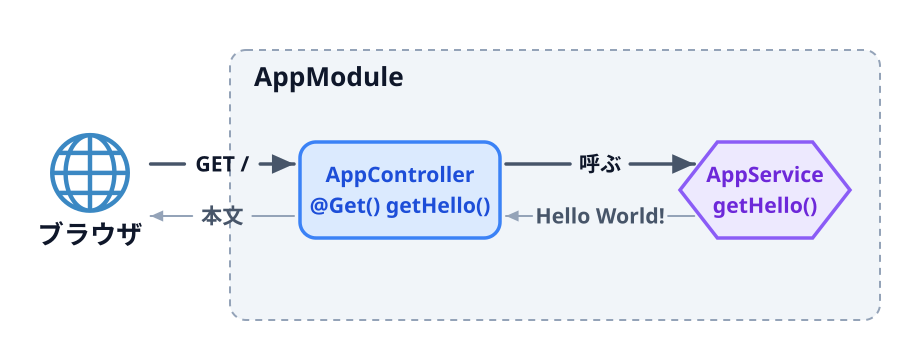

# NestJS の Hello World


この節では、**NestJS** のプロジェクトを作り、「Hello World!」を返す API を動かします。このプロジェクト（`api/`）に、03 章で API の設計（`openapi.yaml`）を書き、04 章でメモを読み書きする REST API を実装します。

NestJS は、Node.js で API を作るためのフレームワークです。URL ごとの処理（コントローラー）と処理の中身（サービス）を分けて書き、それらをモジュールにまとめます。

## NestJS のプロジェクトを作る

作業用のフォルダを作り、その中で Nest CLI を使ってプロジェクトを作ります。

```bash
mkdir handson
cd handson
npx @nestjs/cli@12 new api --package-manager npm --skip-tests --type esm --no-observe --skip-skills
```

Nest CLI の 12 系で `api/` を作り、ライブラリのインストールまで行います。`--skip-tests` でテストのファイルを作らず、`--type esm` でモジュールの方式を ESM にし、`--no-observe` で監視サービス（NestJS Observe）の設定を、`--skip-skills` でコーディングエージェント向けのスキルのファイルを飛ばします。

以降のコマンドは、`api/` の中で実行します。VS Code で `api/` を開いておきます。

```bash
cd api
code .
```

主なファイルは次のとおりです。

| ファイル | 役割 |
|---|---|
| `src/main.ts` | アプリを起動する入り口。ポート番号もここで決める |
| `src/app.module.ts` | モジュール。コントローラーとサービスをまとめる |
| `src/app.controller.ts` | コントローラー。URL とメソッドに応じて処理を呼ぶ |
| `src/app.service.ts` | サービス。実際の処理（ここでは文字列を返すだけ） |
| `package.json`・`package-lock.json` | 使うライブラリとコマンド（`scripts`） |
| `tsconfig.json`・`tsconfig.build.json`・`nest-cli.json` | TypeScript と Nest CLI の設定 |

## 動かす

```bash
npm run start:dev
```

```text
[Nest] 53212  - 2026/11/20 11:37:13     LOG [NestFactory] Starting Nest application...
[Nest] 53212  - 2026/11/20 11:37:13     LOG [InstanceLoader] AppModule dependencies initialized +4ms
[Nest] 53212  - 2026/11/20 11:37:13     LOG [RoutesResolver] AppController {/}:
[Nest] 53212  - 2026/11/20 11:37:13     LOG [RouterExplorer] Mapped {/, GET} route
[Nest] 53212  - 2026/11/20 11:37:13     LOG [NestApplication] Nest application successfully started
```

`Mapped {/, GET} route` は「`GET /` を受け付ける」という意味です。ブラウザで <http://localhost:3000> を開くと `Hello World!` と表示されます。

`start:dev` は、ファイルを保存すると自動で再起動します。止めるときは Ctrl + C を押します。ポート番号は `src/main.ts` で決まっています。

:::code{filepath="api/src/main.ts"}
```ts
import { NestFactory } from '@nestjs/core';
import { AppModule } from './app.module.js';

async function bootstrap() {
  const app = await NestFactory.create(AppModule);
  await app.listen(process.env.PORT ?? 3000);
}
await bootstrap();
```
:::

`process.env.PORT ?? 3000` は「環境変数 `PORT` があればその値、無ければ 3000」という意味です。

## リクエストが届くまで

`GET /` が届くと、NestJS は `AppModule` の `AppController` から `@Get()` が付いた `getHello()` を呼びます。コントローラーは `AppService` の `getHello()` を呼び、返ってきた文字列がレスポンスの本文になります。



:::code{filepath="api/src/app.controller.ts"}
```ts
@Controller()
export class AppController {
  constructor(private readonly appService: AppService) {}

  @Get()
  getHello(): string {
    return this.appService.getHello();
  }
}
```
:::

`constructor(private readonly appService: AppService)` と書くだけで、NestJS が `AppService` のインスタンスを作って渡してくれます。これを **依存性の注入（DI）** と呼びます。

:::notice
NestJS 12 のプロジェクトは ES Modules で書かれています。`import { AppService } from './app.service.js'` のように、TypeScript のファイルでも import の末尾は `.js` にします（ビルド後のファイル名に合わせるため）。
:::

## ビルドする

```bash
npm run build
```

TypeScript をコンパイルして `dist/` に書き出します。このハンズオンでは、節の終わりにビルドが通ることを確かめています。

## 参考にした公式ドキュメント

この節は、次の公式ドキュメントをもとに書いています。

- [NestJS: First steps](https://docs.nestjs.com/first-steps) … `nest new` で作るプロジェクトのファイルと `main.ts`、`npm run start:dev`
- [NestJS: CLI command reference](https://docs.nestjs.com/cli/usages) … `nest new` の `--skip-tests`・`--type`・`--no-observe`・`--skip-skills`
- [NestJS: Controllers](https://docs.nestjs.com/controllers) … `@Controller()`・`@Get()` とルートの決まり方
- [NestJS: Providers](https://docs.nestjs.com/providers) … サービスとコンストラクターでの依存性の注入

## この節を終えたときのディレクトリ

::tree

:::download
[この節を終えた状態をダウンロード](./project.zip)
:::

:::faq

### `npm run start:dev` で `EADDRINUSE: address already in use :::3000` と出る

3000 番ポートを別のプログラムが使っています。前に起動した API が別のターミナルに残っていないか確かめ、Ctrl + C で止めてください。

### ZIP をダウンロードして始めたら動かない

ZIP には `node_modules/` が入っていません。展開した `api/` で `npm install` を実行してから動かしてください。

:::
