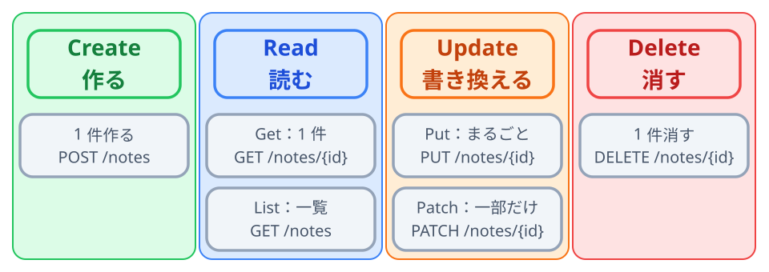

# CRUD

データを扱う API の操作は、作る（Create）・読む（Read）・書き換える（Update）・消す（Delete）の 4 つが基本です。頭文字を取って **CRUD** と呼びます。

CRUD は 4 つの言葉ですが、1 つの言葉の中に、いくつかの形があります。

操作の種類は **メソッド**（`POST`・`GET` など）で、対象は **パス** で表します。`/notes` はメモ全体、`/notes/{id}` は `id` で決まる 1 件のメモです。

## Create

メモを 1 件作ります。`POST /notes` に中身を送ると、`id` の付いたメモができます。

## Read

読む操作には、2 つの形があります。

- **Get** … `id` を指定して、1 件を読みます（`GET /notes/{id}`）
- **List** … メモの一覧を読みます（`GET /notes`）

どちらも `GET` ですが、返るものが「1 件」か「一覧」かで別の操作になります。

## Update

書き換える操作にも、2 つの形があります。

- **Put** … 送った中身で、まるごと置き換えます（`PUT /notes/{id}`）。`title` と `body` の両方を送ります
- **Patch** … 送った項目だけを書き換えます（`PATCH /notes/{id}`）。`title` だけを送れば、`body` はそのまま残ります

このハンズオンでは `PUT` を使います。

## Delete

メモを 1 件消します（`DELETE /notes/{id}`）。

## メモの API で設計する操作

メモの API では、次の 5 つを、1 節に 1 つずつ OpenAPI で設計します。

| 節 | 操作 | メソッド | パス |
|---|---|---|---|
| 作成の設計 | Create | `POST` | `/notes` |
| 単一取得の設計 | Read（Get） | `GET` | `/notes/{id}` |
| 一覧取得の設計 | Read（List） | `GET` | `/notes` |
| 更新の設計 | Update（Put） | `PUT` | `/notes/{id}` |
| 削除の設計 | Delete | `DELETE` | `/notes/{id}` |

## 参考にした公式ドキュメント

この節は、次の公式ドキュメントをもとに書いています。

- [RFC 9110: HTTP Semantics](https://www.rfc-editor.org/rfc/rfc9110.html#name-method-definitions) … `GET`・`POST`・`PUT`・`DELETE` の意味
- [RFC 5789: PATCH Method for HTTP](https://www.rfc-editor.org/rfc/rfc5789.html) … `PATCH` の意味
