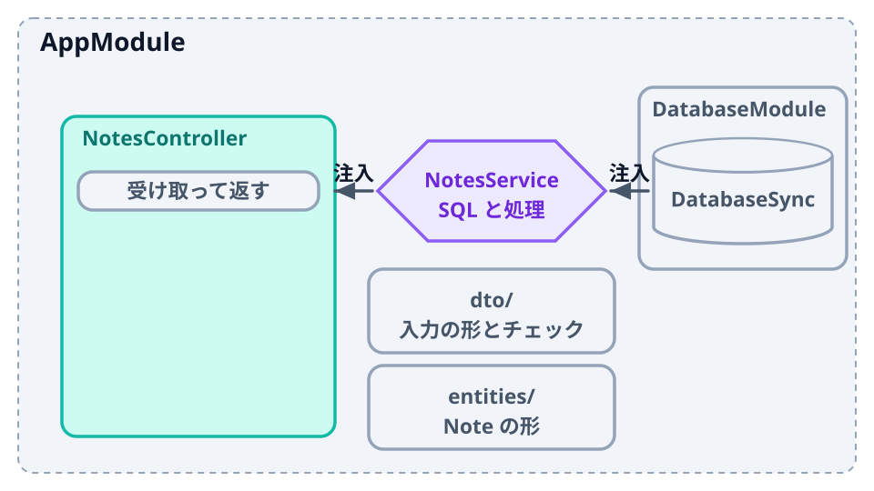

# 処理をサービスに分ける


SQL と処理を **サービス** に移し、コントローラーは「受け取って、サービスを呼んで、返す」だけにします。データベースは、コントローラーではなくサービスに注入します。



```bash
npx nest g service notes
```

```text
CREATE src/notes/notes.service.ts (89 bytes)
UPDATE src/app.module.ts (484 bytes)
```

`AppModule` の `providers` に `NotesService` が登録されます。

::diff{file="api/src/app.module.ts" by="command"}

::diff{file="api/src/notes/notes.service.ts" base="generated"}

- メソッドの中身は、コントローラーにあったものをそのまま移しています
- データベースは、サービスのコンストラクターで受け取ります

::diff{file="api/src/notes/notes.controller.ts"}

- 入力チェック（`schema`）と応答のステータス（`@HttpCode(204)`）は、HTTP の決まりなのでコントローラーに残します

## 動作確認する

`npm run start:dev` で起動したまま、`api/openapi.yaml` の 5 つの操作を **Try it** で送ります。04 章の最後と同じ応答（`200`・`201`・`204`・`400`・`404`）が返れば、整理しても動きは変わっていません。

## 参考にした公式ドキュメント

この節は、次の公式ドキュメントをもとに書いています。

- [NestJS: Providers](https://docs.nestjs.com/providers) … サービス（`@Injectable()`）と依存性の注入

## この節を終えたときのディレクトリ

::tree

:::download
[この節を終えた状態をダウンロード](./project.zip)
:::
